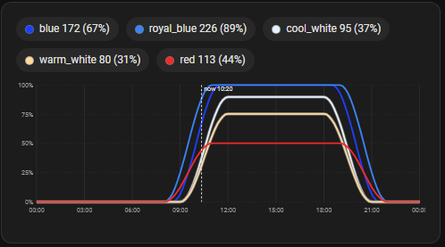
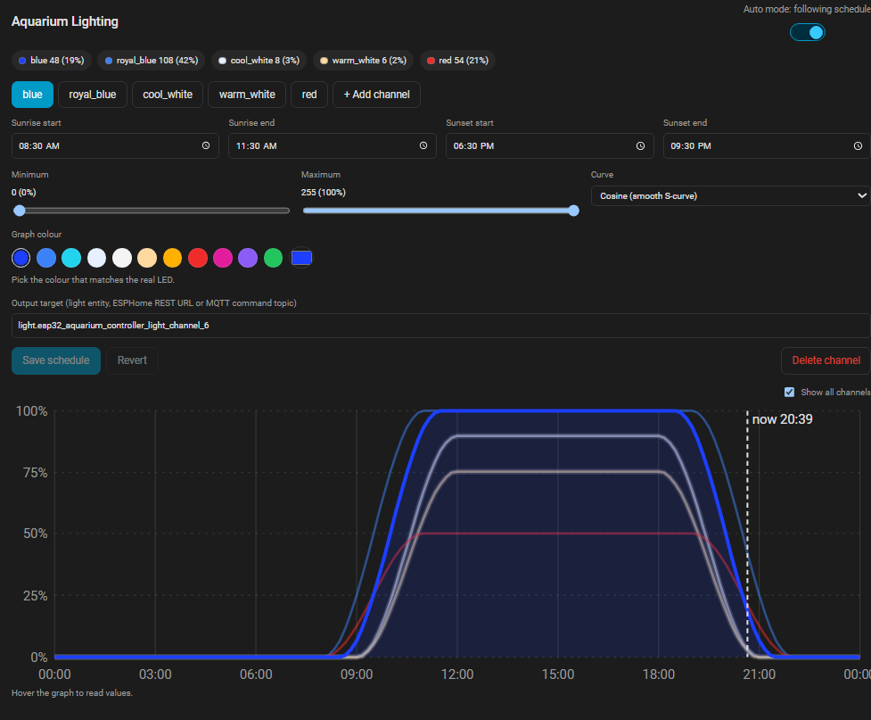

# Aquarium Lighting for Home Assistant

Schedule-driven, multi-channel aquarium lighting with long, smooth ramps. It runs
entirely inside Home Assistant: no automations, no SQL, no cloud.

- Independent schedule per channel (blue, white, UV, warm white, ...)
- Curves: linear, cosine, parabolic, multi-segment (custom points)
- An auto-mode toggle (an `input_boolean` you create) hands control to the
  integration or back to you; one toggle per aquarium
- Per-channel graph colours, so lines match the real LEDs
- Outputs: HA light entities, ESPHome REST, or MQTT
- Every schedule parameter is also an editable entity (number / time / select),
  usable from any card, script, automation or voice assistant
- Two Lovelace cards: a full schedule editor with live curve preview, and a
  graph-only card for a main display
- Brightness is never stored; it is always computed from schedule + clock

Requires Home Assistant **2024.11 or newer**.

---

## Install

### 1. Get the files

**HACS (recommended):** open HACS → ⋮ → **Custom repositories**, add this
repository's URL with category **Integration**, then download **Aquarium Lighting**
and restart Home Assistant.

**Manual:** copy `custom_components/aquarium_lighting/` into
`<config>/custom_components/aquarium_lighting/` and restart Home Assistant.

### 2. Set up

1. **Create the auto-mode toggle** (one per aquarium):
   **Settings → Devices & services → Helpers → Create helper → Toggle**, name it
   `Aquarium Auto Mode` (entity id `input_boolean.aquarium_auto_mode`). For a second
   tank, create another one, e.g. `Reef Auto Mode`.
2. **Settings → Devices & services → Add integration → Aquarium Lighting.**
   - Step 1: aquarium name, the toggle from step 3, output mode, transition lengths.
   - Step 2: name and target of your first channel.
   - Run the integration again for another aquarium; each uses its own toggle.
3. Add the cards to a dashboard (see **Lovelace cards**). More channels, targets,
   schedules and colours are all edited from the editor card.
4. Turn the toggle on when you are ready. Auto mode follows the toggle, so it
   survives restarts the way any helper does (HA restores its state).

**The cards load automatically.** On start the integration registers its script as a
dashboard resource (Settings → Dashboards → Resources shows
`/aquarium_lighting/aquarium-lighting-card.js?v=...`), updates it when you upgrade, and
removes it when you delete the integration. A resource you added by hand is updated, not
duplicated. If your dashboards use **YAML resource mode** this cannot be done from code:
add it to your dashboard YAML instead:

```yaml
lovelace:
  resources:
    - url: /aquarium_lighting/aquarium-lighting-card.js
      type: module
```

If a card still says "Custom element doesn't exist", restart Home Assistant and
hard-refresh the browser (Ctrl+Shift+R).

### Upgrading from 0.1

- The `switch.aquarium_auto_mode` entity is gone and is removed automatically.
- Create the toggle helper (step 3). Older entries default to
  `input_boolean.aquarium_auto_mode`; to use a different helper, open the
  integration's **Configure** and pick it.
- Delete the old `switch.py` from the integration folder (it is no longer used).
- Schedules are kept.

---

## How it works

### Schedule

One entry per channel, stored in HA's `.storage/aquarium_lighting.<entry_id>`
(JSON, survives restarts and is included in HA backups):

```json
{
  "blue": {
    "sunrise_start": "08:00",
    "sunrise_end":   "11:00",
    "sunset_start":  "17:00",
    "sunset_end":    "20:00",
    "min": 10,
    "max": 255,
    "curve": "cosine",
    "points": [],
    "target": "light.reef_blue",
    "color": "#1d3fff"
  }
}
```

`min`/`max` use the Home Assistant scale (0-255). `target` depends on the output
mode. `points` is only used by `multi_segment`. `color` is the graph colour
(`#rrggbb`); leave it empty and the cards guess one from the channel name
(`cool_white`, `red`, `uv`, ...).

Times must run in order within 24 h (sunrise start → sunrise end → sunset start →
sunset end). A ramp may cross midnight (for example sunset 22:00 → 01:00).

### Curves

| Curve | Shape of each ramp |
|---|---|
| `linear` | Constant rate of change |
| `cosine` | `(1 − cos(πp)) / 2`, gentle start and finish (best for long ramps) |
| `parabolic` | Quadratic ease-in / ease-out (`2p²`, then `1 − 2(1−p)²`) |
| `multi_segment` | Your own `[["HH:MM", level], ...]` points, linearly interpolated and repeating every 24 h. Sunrise/sunset times are ignored. Add many points to approximate any shape. Levels are clamped to min/max |

Outside the ramps the level is `max` between sunrise end and sunset start, and
`min` overnight. `min: 0` turns the light fully off at night (`light.turn_off` is
sent instead of brightness 0).

### The background task (`coordinator.py`)

- One `asyncio` task per config entry, waking at the top of every minute.
- Each tick it computes every channel from schedule + local time and pushes it.
- **Auto mode** is the state of your `input_boolean`; the integration listens
  for changes (it also reads it when HA finishes starting).
- **Auto OFF:** the task parks on an `asyncio.Event`. It does not wake, compute or
  push anything until auto is switched on again.
- **Auto ON, anywhere:** switching the toggle on (or HA starting with it on, or
  saving an edit) triggers an immediate push of the level the schedule has *right now*,
  using the short "resume" transition. The next minute continues the ramp exactly
  as if auto had never been paused, because nothing about the ramp was stored.
- Errors on one channel (device offline, entity missing) are logged once and
  retried every minute; one bad channel never affects the others, and the loop
  cannot die.
- On HA start the task waits for the `homeassistant_started` event, so light
  entities and MQTT exist before the first push.

### Smooth ramps

Brightness is pushed once a minute, but fades are interpolated by the light:

- Each tick sends **the level the schedule will have one transition from now**
  plus the transition length (default 60 s). The device reaches that level exactly
  when the next tick arrives, so the fade tracks the schedule with no lag and no
  staircase. (A unit test simulates this and shows the lag you would otherwise get.)
- **Ramp transition** (default 60 s) applies to regular ticks.
- **Resume / edit transition** (default 15 s) applies to the first push after
  switching auto on, HA restart, or a schedule edit.
- Both are options (**Configure** on the integration card).

### Output modes

| Mode | Target value | What is sent |
|---|---|---|
| `ha_light` | a light entity id, e.g. `light.reef_blue` | `light.turn_on` with `brightness` and `transition` (`turn_off` at level 0) |
| `esphome_rest` | ESPHome light URL, e.g. `http://reef-light.local/light/blue` | `POST <url>/turn_on?brightness=..&transition=..` (or `turn_off`). Basic-auth credentials may be embedded in the URL |
| `mqtt` | the light's command topic, e.g. `reef-light/light/blue/command` | JSON `{"state":"ON","brightness":..,"transition":..}` (ESPHome JSON light schema); needs the MQTT integration |

`ha_light` works with any light that honours `transition`, not only ESPHome. The
mode is global for the install; if your rig mixes device types, expose them all as
HA light entities and use `ha_light`.

### Auto vs manual

- Toggle **ON**: the integration owns brightness. Anything you set by hand on a
  controlled light is overwritten at the next tick (within a minute). That is the
  point of auto mode.
- Toggle **OFF** (or unavailable / deleted): the integration sends nothing. Use the
  lights normally.
- Flip it back on at any time: the level for the current time is applied smoothly
  and the ramp carries on as if auto had never been paused.
- You can switch the toggle from the card, the HA UI, a dashboard button or any
  other HA feature, since it is a normal `input_boolean`.

---

## Entities

Each channel becomes a device (for example **Reef Blue**; a setup carried over from 0.1 has no aquarium name, so its ids start with `aquarium_`) with these entities, so
you can edit parameters from any dashboard card, script, automation or voice
assistant without the editor card:

| Entity | What it is |
|---|---|
| `time.<aquarium>_<channel>_sunrise_start` | when the sunrise ramp begins |
| `time.<aquarium>_<channel>_sunrise_end` | when it reaches maximum |
| `time.<aquarium>_<channel>_sunset_start` | when the sunset ramp begins |
| `time.<aquarium>_<channel>_sunset_end` | when it reaches minimum |
| `number.<aquarium>_<channel>_minimum_brightness` | 0-255 |
| `number.<aquarium>_<channel>_maximum_brightness` | 0-255 |
| `select.<aquarium>_<channel>_curve` | linear, cosine, parabolic, multi_segment |

(`<aquarium>` is the name you gave in setup, `<channel>` the channel name; the
exact ids are shown on the device page.)

- They are **views of the schedule**, not separate settings: edit one here and the
  editor card shows it; save in the card and these update. If auto mode is on, a
  change takes effect immediately with the short "resume" fade.
- They are in the **Configuration** category, so they do not clutter automatically
  generated dashboards. Add them to any dashboard yourself.
- Channels added or deleted in the editor card appear or disappear here.
- A change that makes the schedule invalid (times out of order, minimum above
  maximum) is refused with an explanation. When moving several times, change them
  in an order that stays valid, for example move a later time first when shifting
  everything later.
- Choosing `multi_segment` on an entity starts from points that match the current
  ramps; fine-tune the points in the editor card. For `multi_segment` channels the
  sunrise/sunset times are ignored.
- Output target, graph colour and multi-segment points are edited in the card
  (they are not numbers or times).
- The editor card reads the schedule when it loads and once a minute, so a change
  made through an entity can take up to a minute to appear in an open card.

## Lovelace cards

Both cards are in the same JavaScript file. With one aquarium no configuration is
needed. With several, set `auto_entity` to the aquarium's toggle so the card
knows which one it shows.





### Schedule editor (config dashboard)

```yaml
type: custom:aquarium-lighting-card
title: Reef lighting                       # optional
auto_entity: input_boolean.reef_auto_mode  # optional with one aquarium
show_all: true                             # optional: default for "Show all channels"
```

- Auto-mode toggle (the `input_boolean`).
- One tab per channel, plus **Add channel**.
- Sunrise/sunset times, min/max sliders, curve selector, multi-segment point editor,
  graph colour (presets for common LED colours plus a free colour picker), output
  target.
- 24 h graph: the selected channel is drawn from your **unsaved edits** at full
  strength. **Show all channels** adds the others at 50% opacity (your choice is
  remembered in the browser). A dashed line marks "now", and hovering lists every
  visible channel's level at that time.
- Saving and deleting require an HA admin user.

### Graph only (main display)

```yaml
type: custom:aquarium-lighting-graph-card
title: Lighting                            # optional; omit for no header
auto_entity: input_boolean.reef_auto_mode  # optional with one aquarium
channels: [blue, cool_white, red]          # optional: only these channels
show_legend: true                          # optional: channel names + current %
```

Every channel is drawn at full opacity in its own colour with the current-time
line, refreshed every minute. Very light or very dark colours get a thin grey
outline so they stay visible on any theme.

### Websocket API

| Command | Fields | Notes |
|---|---|---|
| `aquarium_lighting/get` | `auto_entity` (optional) | schedules, auto flag, current levels, 10-minute curves |
| `aquarium_lighting/preview` | `schedule`, `step` (1-120) | evaluates an unsaved draft |
| `aquarium_lighting/set_channel` | `name`, `schedule`, `auto_entity` (optional) | admin; validates and saves; triggers an immediate re-apply when auto is on |
| `aquarium_lighting/delete_channel` | `name`, `auto_entity` (optional) | admin |

Turn auto mode on or off by calling `input_boolean.turn_on` / `turn_off` on the toggle.

Validation errors come back as `invalid_schedule` with a readable message.

---

## ESPHome

See `esphome/aquarium-light.yaml`: four PWM channels with
`default_transition_length: 60s`, `gamma_correct: 2.2`, `restore_mode:
RESTORE_DEFAULT_ON`, plus the native API, REST (`web_server`) and MQTT variants.

- The integration always sends an explicit transition, so
  `default_transition_length` is the fallback for commands that arrive without one
  (manual on/off from the HA UI, for example).
- The ESP holds its last level if HA goes down, then picks up the schedule within
  a minute of HA coming back. If the ESP reboots, it restores its saved state and
  is corrected at the next tick.
- Confirm the REST path for your ESPHome version with `curl` before pointing the
  integration at it (the YAML shows an example).

---

## Files

```
custom_components/aquarium_lighting/
  manifest.json        integration metadata
  __init__.py          setup/unload, registers card + websocket API
  coordinator.py       background task, storage, output back-ends
  light_controller.py  brightness engine (pure Python, no HA imports)
  config_flow.py       setup + options flow
  entity.py            shared base for the channel entities
  number.py time.py select.py   per-channel min/max, sunrise/sunset times, curve
  api.py               websocket API for the card
  card_resource.py     serves the card script and registers it as a dashboard resource
  const.py             constants
  strings.json, translations/en.json
  frontend/aquarium-lighting-card.js   Lovelace cards (editor + graph-only)
esphome/aquarium-light.yaml            example node with smoothing
tests/test_light_controller.py         engine tests (run with pytest, no HA needed)
```

## Design notes and limits

- **Nothing about current brightness is persisted.** Only schedules and the
  auto flag are. A restart, a pause of any length, or an edit cannot cause drift.
- **Time zone:** schedules use Home Assistant's configured time zone. During a DST
  change the wall clock jumps, so a ramp in progress jumps with it; this is
  usually what you want for a day/night cycle.
- **Several aquariums:** add the integration once per aquarium, each with its own
  toggle, channels and output mode. Entries are matched to cards by `auto_entity`.
- **Granularity:** the engine runs once a minute; smoothness within the minute
  depends on the device's transition support.
- Writes go through HA's storage helper; keep `.storage` in your backups.

## Troubleshooting

| Symptom | Check |
|---|---|
| Card says it cannot reach the integration | Integration is set up? Hard-refresh the browser |
| "entity ... does not exist (yet)" in logs | The `target` entity id is wrong, or the device was not up yet (retried every minute) |
| Lights jump instead of fading | The light ignores `transition`; use an ESPHome light, or the REST/MQTT modes |
| Nothing happens | The toggle is off, or the helper does not exist (the log says so), or the channel has an empty target |
| Toggle in the card is greyed out | The `input_boolean` entity id does not exist; create the helper or change it under **Configure** |
| REST 404 | The ESPHome path differs by version; test with `curl`, then paste the working base URL |
| MQTT mode does nothing | MQTT integration must be configured; use the light's actual command topic |

## Tests

```bash
pip install pytest-homeassistant-custom-component   # needs Python 3.13+
pytest tests/
```

- `tests/test_light_controller.py`: the brightness engine (plateaus, ramp shape and
  continuity, midnight wrap, multi-segment, validation, look-ahead smoothing model).
  These also run with plain `pytest` and no Home Assistant.
- `tests/test_integration.py`: runs in a real Home Assistant: setup, the per-channel
  entities, editing through entities, refusal of invalid values, auto mode following
  the `input_boolean` and pushing to lights, and adding/deleting channels over the
  websocket API.
